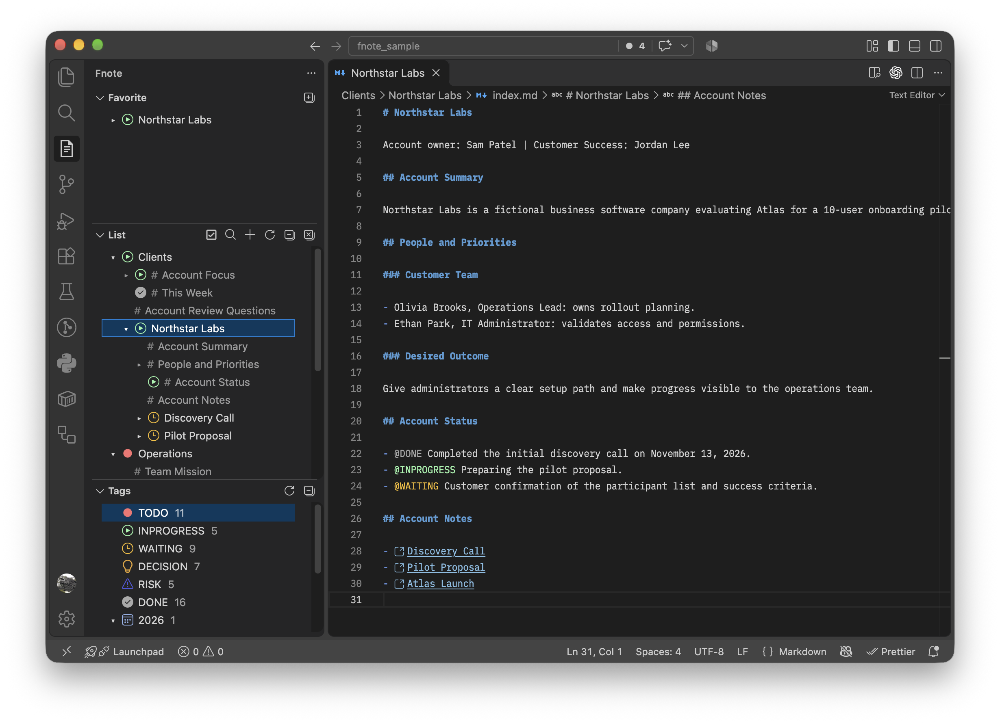

# fnote

fnoteは、VS CodeでMarkdownを使用してメモや作業の記録を管理するための拡張機能です。

## 主な機能

- 階層構造で整理
  ノートに子ノートを作成することができます。また、Markdownの見出しもノートの一覧に表示できます。
- タグの追加
  タグを追加することができます。タグは`@`の後に単語を追加することで作成できます。ノート内に`@TODO`と記載すると`TODO`タグが作成されます。
  タグ一覧から目的のタグのついたノートをすぐに探せます。
- 日付、時刻タグ
  `@2026/11/15 @11:00-12:00`のようにタグを記載すると、年、月、日のそれぞれの合計時間をノートごとに出力することができます。
- よく使用するノートは、お気に入りに追加することができます。
- 終了したノートはアーカイブすることができます。ノート一覧でアーカイブされたノートを表示するかどうかを指定できます。
- ノート一覧やタグ一覧にあるアイコンや色をカスタマイズすることができます。アイコンには文字や絵文字を指定できますが、下記のURLにあるアイコンも使用することができます。
  <https://microsoft.github.io/vscode-codicons/dist/codicon.html>



## 設定

VS Codeの設定画面で `@ext:maoren.fnote` を検索すると、fnoteの設定を表示できます。JSONで編集する場合は、コマンドパレットから **Preferences: Open User Settings (JSON)** を開き、既存の `{ ... }` 内に設定を追加してください。

| 設定名                     | 既定値                       | 説明                                                                                                                              |
|----------------------------|------------------------------|-----------------------------------------------------------------------------------------------------------------------------------|
| `fnote.storagePath`        | `"~/.fnote"`                 | ノートの保存先。絶対パス、`~/` で始まるパス、`${workspace}/.fnote` などを指定できます。空文字列は拡張機能の保存領域を使用します。 |
| `fnote.untaggedNoteMark`   | `"$(note)"`                  | アイコン候補となるタグがないノートのアイコン。                                                                                    |
| `fnote.defaultTagMark`     | `"$(circle-filled-compact)"` | タグの既定アイコン。                                                                                                              |
| `fnote.headingMark`        | `"#"`                        | ノート一覧のMarkdown見出しに付ける印。                                                                                            |
| `fnote.headingMarkColor`   | `"#808080"`                  | Markdown見出しの印の色。                                                                                                          |
| `fnote.dateTagSort`        | `"note"`                     | タグ検索結果の初期表示。`"note"` はノート一覧の順番、`"time"` は日付ごとにまとめてノートをまたいだ時刻順で表示します。            |
| `fnote.linkMark`           | `"$(link-external)"`         | ノートエディタやタグ・検索結果のリンクアイコン。                                                                                  |
| `fnote.attachmentMark`     | `"$(attach)"`                | ノートエディタやノート一覧の添付ファイルのアイコン。                                                                              |
| `fnote.attachmentColor`    | `""`                         | 添付ファイルのアイコンの色。空文字列は現在の文字色を使用します。                                                                  |
| `fnote.archiveMark`        | `"$(archive)"`               | アーカイブ済みノートのアイコン。                                                                                                  |
| `fnote.archiveColor`       | `"#808080"`                  | アーカイブ済みノートのアイコンの色。                                                                                              |
| `fnote.tagColor`           | `"#00BFFF"`                  | タグの既定の文字色。                                                                                                              |
| `fnote.tagBackgroundColor` | `""`                         | ノートエディタや検索結果のタグの既定の背景色。空文字列は背景色なしです。                                                          |
| `fnote.tagStyles`          | 下記参照                     | タグごとのアイコン・文字色・背景色と、ノートアイコン選択時の優先順位。                                                            |
| `fnote.tagHierarchy`       | `{}`                         | タグのグループ化。例：`{ "状態": ["TODO", "完了"] }`。本文のタグ名を変えずに、親タグから子タグに一致するノートを検索できます。    |

アイコンや印には文字・絵文字・`$(book)` などのVS Codeアイコン名を指定できます。空文字列 `""` を指定するとアイコンや印を非表示にできます。色には `"#FF5555"` などのカラーコードを指定します。

`fnote.storagePath` を変更した後は **Developer: Reload Window** を実行してください。`${workspace}` と `${workspaceFolder}` は最初のワークスペースフォルダーを指します。既存のノートは自動で移動しないため、保存先を変更する場合はノートのフォルダーもコピーしてください。

### タグごとの設定

`fnote.tagStyles` の既定値は次のとおりです。

```json
{
  "fnote.tagStyles": [
    { "tag": "FIX", "mark": "$(bug)", "color": "#f87171" },
    { "tag": "TODO", "mark": "$(circle-filled-compact)", "color": "#f87171" },
    { "tag": "Incomplete time tags", "mark": "$(clock)", "color": "#fbbf24", "excludeFromNoteMark": true },
    { "tag": "date", "mark": "$(calendar)", "excludeFromNoteMark": true }
  ]
}
```

| 項目                  | 説明                                                                                                           |
|-----------------------|----------------------------------------------------------------------------------------------------------------|
| `tag`                 | `@` を除いたタグ名（必須）。`date` は日付タグ共通、`Incomplete time tags` は未完了の時刻タグの設定です。       |
| `mark`                | タグのアイコン。文字・絵文字・VS Codeアイコン名を指定できます。                                                |
| `markColor`           | アイコンの色。未指定の場合は `color`、祖先タグの色、自動生成色の順に使用します。絵文字自体の色は変わりません。 |
| `color`               | タグの文字色。                                                                                                 |
| `backgroundColor`     | タグの背景色。空文字列は背景色なしです。                                                                       |
| `excludeFromNoteMark` | `true` にするとノートのアイコン候補から除外します。既定値は `false` です。タグ一覧には引き続き表示されます。   |

配列の上にある設定ほどノートのアイコン選択時に優先されます。子タグは親タグの設定を引き継ぎ、個別の設定で上書きできます。`fnote.tagStyles` を設定すると既定の配列を置き換えるため、残したい項目も含めて指定してください。
