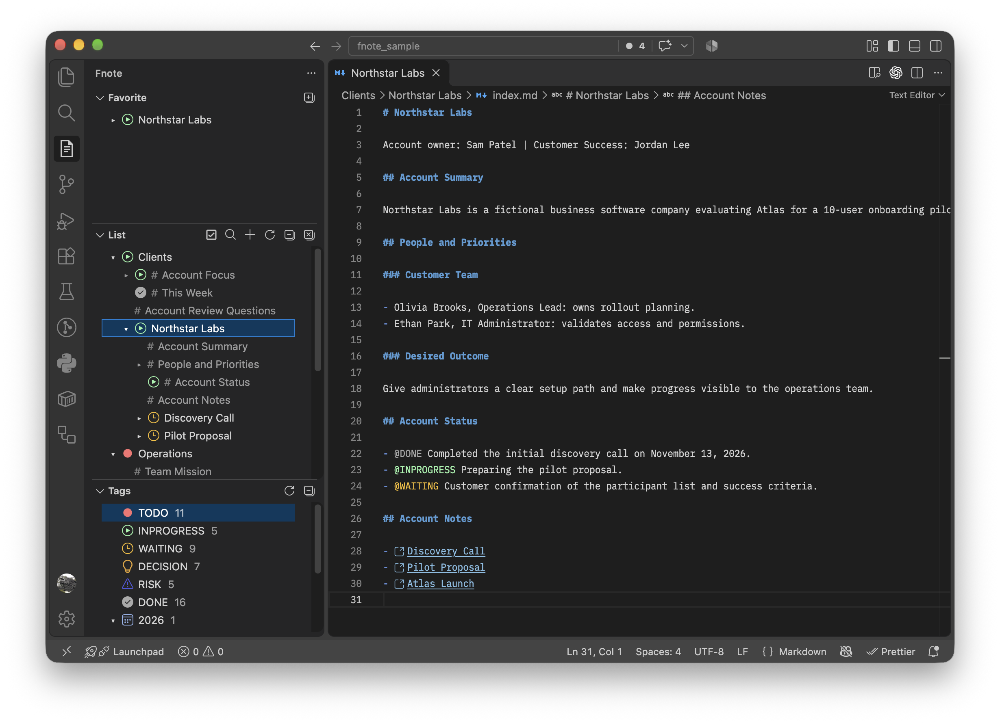

# fnote

fnote is a VS Code extension for managing notes and work logs in Markdown.

## Main features

- Organize notes in a hierarchy
  Create child notes within a note. Markdown headings can also appear in the note list.
- Add tags
  Create a tag by adding a word after `@`. For example, writing `@TODO` in a note creates a `TODO` tag.
  Use the tag list to quickly find notes with a particular tag.
- Date and time tags
  Add tags such as `@2026/11/15 @11:00-12:00` to see yearly, monthly, and daily time totals for each note.
- Add frequently used notes to your favorites.
- Archive completed notes. You can choose whether archived notes appear in the note list.
- Customize icons and colors in the note and tag lists. Icons can be text, emoji, or any of the icons listed at the following URL:
  <https://microsoft.github.io/vscode-codicons/dist/codicon.html>



## Settings

Open VS Code Settings and search for `@ext:maoren.fnote` to display fnote's settings. To edit them as JSON, open **Preferences: Open User Settings (JSON)** from the Command Palette and add the settings inside your existing `{ ... }`.

| Setting                    | Default value                | Description                                                                                                                                                                  |
|----------------------------|------------------------------|------------------------------------------------------------------------------------------------------------------------------------------------------------------------------|
| `fnote.storagePath`        | `"~/.fnote"`                 | Where notes are stored. Accepts an absolute path, a path starting with `~/`, or a path such as `${workspace}/.fnote`. An empty string uses the extension's storage location. |
| `fnote.untaggedNoteMark`   | `"$(note)"`                  | Icon for notes without a tag eligible for use as the note icon.                                                                                                              |
| `fnote.defaultTagMark`     | `"$(circle-filled-compact)"` | Default tag icon.                                                                                                                                                            |
| `fnote.headingMark`        | `"#"`                        | Mark displayed before Markdown headings in the note list.                                                                                                                    |
| `fnote.headingMarkColor`   | `"#808080"`                  | Color of the Markdown heading mark.                                                                                                                                          |
| `fnote.dateTagSort`        | `"note"`                     | Initial display mode for tag results. `"note"` follows the note-list order; `"time"` groups entries by date and sorts them by time across notes.                             |
| `fnote.linkMark`           | `"$(link-external)"`         | Link icon in the note editor and tag/search results.                                                                                                                         |
| `fnote.attachmentMark`     | `"$(attach)"`                | Attachment icon in the note editor and note list.                                                                                                                            |
| `fnote.attachmentColor`    | `""`                         | Attachment icon color. An empty string uses the current text color.                                                                                                          |
| `fnote.archiveMark`        | `"$(archive)"`               | Icon for archived notes.                                                                                                                                                     |
| `fnote.archiveColor`       | `"#808080"`                  | Icon color for archived notes.                                                                                                                                               |
| `fnote.tagColor`           | `"#00BFFF"`                  | Default tag text color.                                                                                                                                                      |
| `fnote.tagBackgroundColor` | `""`                         | Default tag background color in the note editor and search results. An empty string means no background color.                                                               |
| `fnote.tagStyles`          | See below                    | Icons, text colors, and background colors for individual tags, and their priority when choosing note icons.                                                                  |
| `fnote.tagHierarchy`       | `{}`                         | Tag groups. For example: `{ "Status": ["TODO", "Done"] }`. Selecting a parent tag finds notes matching its child tags without changing tag names in the note content.        |

Icons and marks accept text, emoji, or VS Code icon names such as `$(book)`. Set an empty string `""` to hide an icon or mark. Specify colors using color codes such as `"#FF5555"`.

After changing `fnote.storagePath`, run **Developer: Reload Window**. `${workspace}` and `${workspaceFolder}` refer to the first workspace folder. Existing notes are not moved automatically, so copy your note folders when changing the storage location.

### Per-tag settings

The default value of `fnote.tagStyles` is:

```json
{
  "fnote.tagStyles": [
    { "tag": "FIX", "mark": "$(bug)", "color": "#f87171" },
    { "tag": "TODO", "mark": "$(circle-filled-compact)", "color": "#f87171" },
    { "tag": "Incomplete time tags", "mark": "$(clock)", "color": "#fbbf24", "excludeFromNoteMark": true },
    { "tag": "date", "mark": "$(calendar)", "excludeFromNoteMark": true }
  ]
}
```

| Field                 | Description                                                                                                                                          |
|-----------------------|------------------------------------------------------------------------------------------------------------------------------------------------------|
| `tag`                 | Tag name without `@` (required). `date` applies to all date tags, and `Incomplete time tags` applies to unfinished time tags.                        |
| `mark`                | Tag icon. Accepts text, emoji, or a VS Code icon name.                                                                                               |
| `markColor`           | Icon color. If omitted, falls back to `color`, then ancestor tag colors, then an automatically generated color. Does not change the colors of emoji. |
| `color`               | Tag text color.                                                                                                                                      |
| `backgroundColor`     | Tag background color. An empty string means no background color.                                                                                     |
| `excludeFromNoteMark` | Set to `true` to exclude this tag when choosing a note icon. Defaults to `false`. The tag still appears in the tag list.                             |

Entries earlier in the array have higher priority when choosing note icons. Child tags inherit their parent tag's settings and can override them individually. Setting `fnote.tagStyles` replaces the default array, so include any default entries you want to keep.
